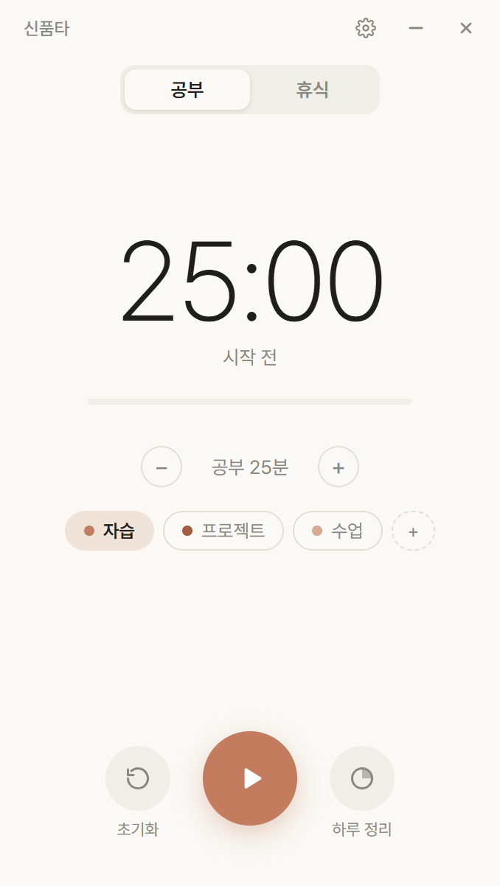
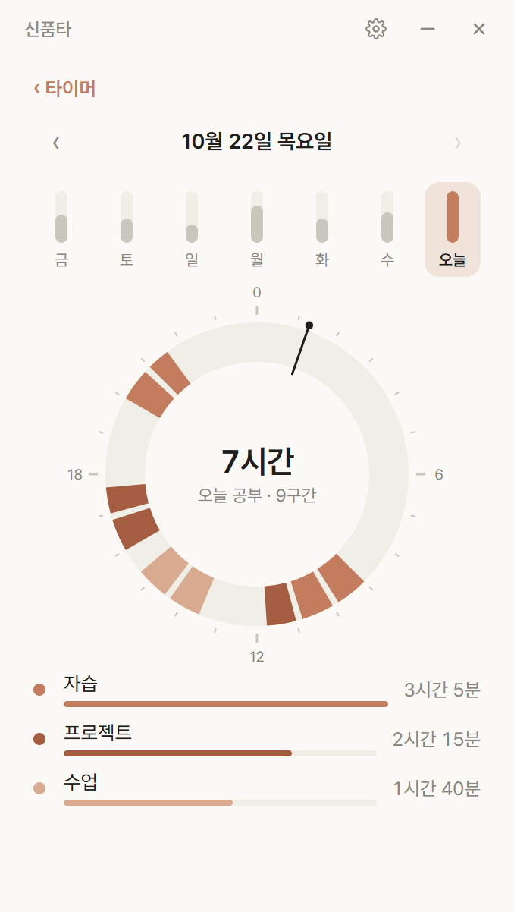
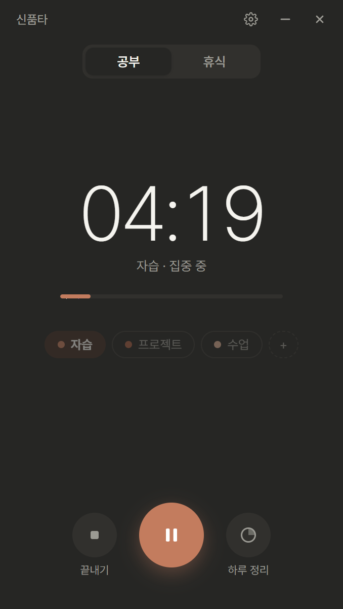

# 신품타 (ShinPumTa)

공부할 때 켜 두는 Windows용 뽀모도로 타이머예요.
집중 시간은 작은 팝업으로 화면 위에 띄워 두고, 하루에 공부한 시간은 24시간 시계로 돌아볼 수 있어요.

  
  
  

## 다운로드

**[신품타 설치 파일 받기 (Windows 10·11, 64비트)](https://github.com/shinu61/ShinPumTa/releases/latest/download/ShinPumTa-Setup.exe)**

지난 버전과 바뀐 점은 [Releases](https://github.com/shinu61/ShinPumTa/releases)에서 볼 수 있어요.

### 설치할 때 "Windows의 PC 보호" 창이 떠요
개인이 만든 앱이라 아직 코드 서명 인증서가 없어서 나오는 안내예요.
**추가 정보 → 실행**을 누르면 설치돼요.

### 업데이트
새 버전 설치 파일을 받아 그대로 설치하면 돼요. 공부 기록과 설정은 그대로 남아요.

## 기능

- **공부 · 휴식 타이머**: 공부는 5분 단위, 휴식은 1분 단위로 정해요. 끝나면 다음 모드로 바뀐 채 기다려요.
- **미니 팝업**: 공부 중에 창을 내리거나 다른 창이 타이머를 다 가리면, 화면 위 가운데에 작은 팝업으로 줄어들어요. 테두리가 시간이 흐르는 만큼 차오르고, 끌어서 옮길 수 있어요(제자리와 화면 가장자리에 자석처럼 붙어요).
- **태그**: 자습 · 프로젝트 · 수업처럼 무엇을 공부했는지 골라 두면 따로 모아 보여줘요. 태그는 직접 추가하고 지울 수 있어요.
- **하루 정리**: 오늘 공부한 구간을 24시간 시계에 그려 주고, 최근 7일 막대로 지난 날도 넘겨 볼 수 있어요.
- **기록 확인**: 공부가 끝날 때마다 저장할지 버릴지 물어봐요.
- **더 공부하기**: 공부 시간이 끝나도 흐름이 좋으면 이어서 공부할 수 있어요. 추가로 한 시간만 따로 저장 여부를 물어봐요.
- **알림**: Windows 알림 설정(무음, 음량, 방해 금지)을 그대로 따르고, 화면에는 항상 완료를 표시해요.
- **테마**: 시스템 · 라이트 · 다크.
- **집중 화면**: OLED 화면에서 2분 동안 입력이 없으면 주변을 어둡게 하고 팝업만 남겨요.

## 개인정보

신품타는 인터넷을 쓰지 않아요. 어떤 정보도 밖으로 보내지 않고, 공부 기록은 내 PC(`%APPDATA%\뽀모도로`)에만 저장돼요.

## 문의

버그나 바라는 점은 [Issues](https://github.com/shinu61/ShinPumTa/issues)에 남겨 주세요.
